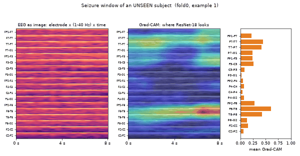
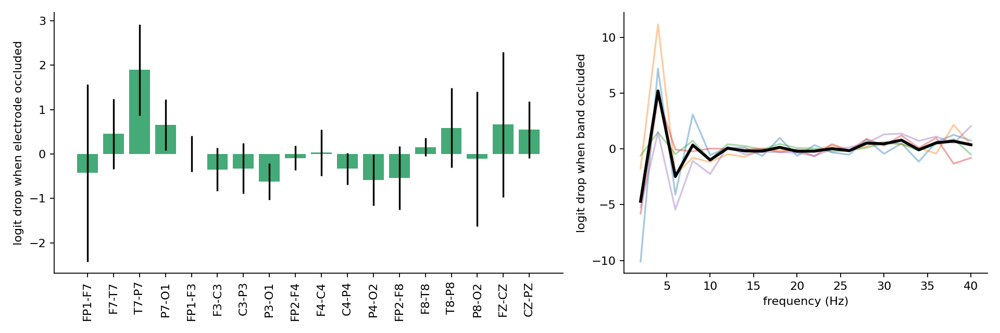
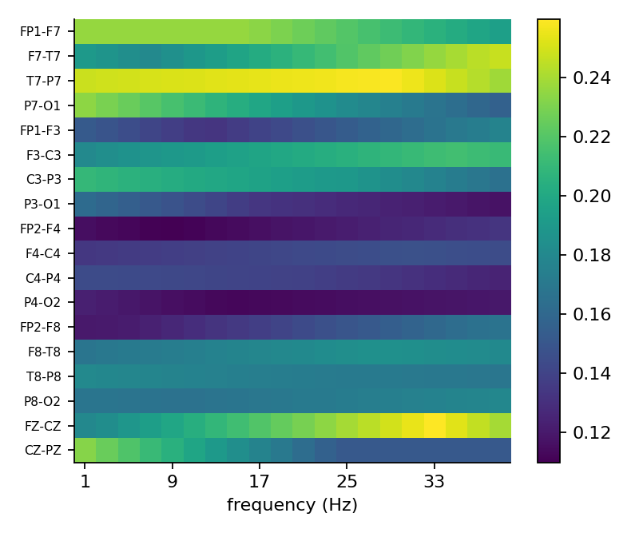
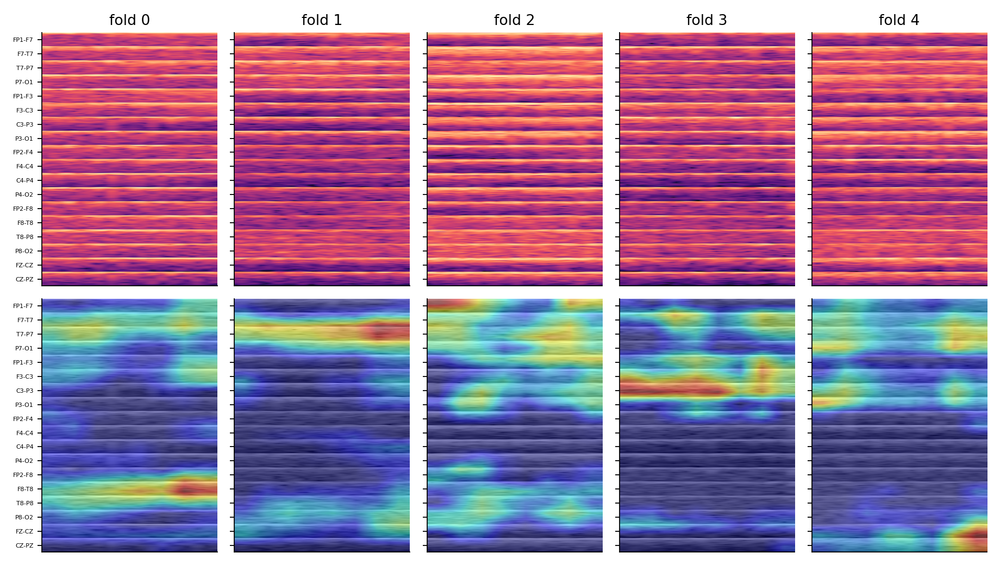
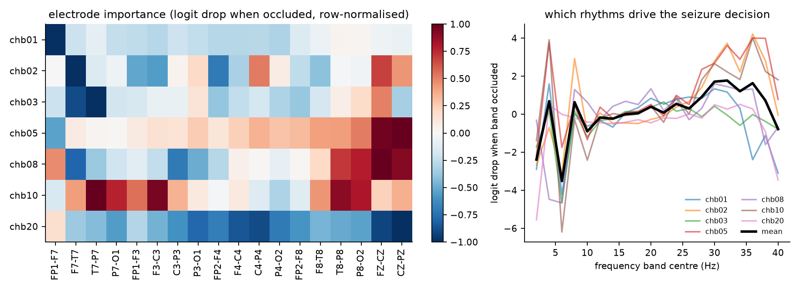
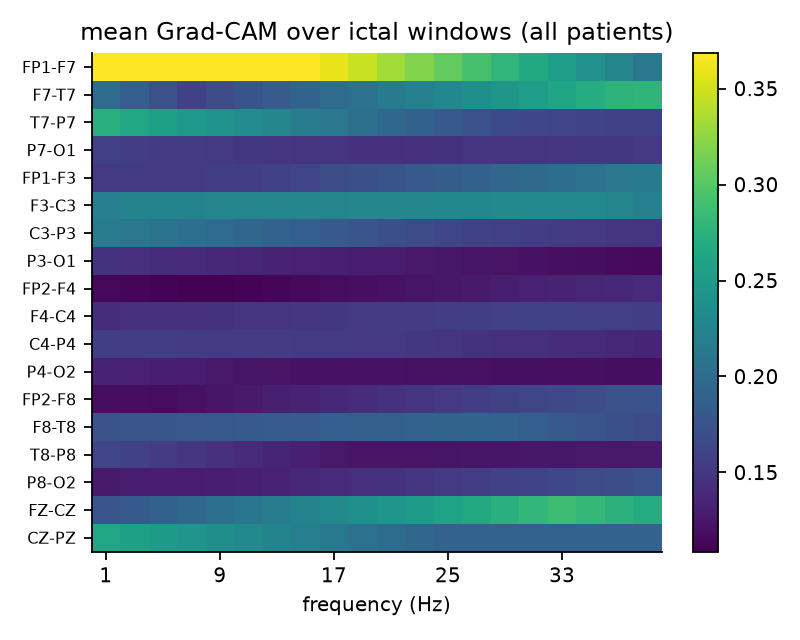
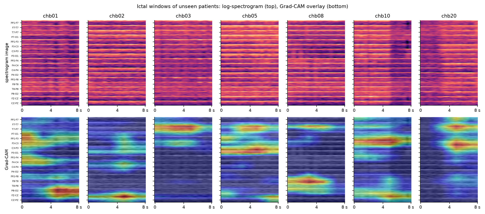

# EEG-Vision-XAI: Explainable Time–Frequency Image Models for Seizure Detection

**Can computer-vision models pre-trained on natural images read EEG, and what do they actually look at?**

Each 8 s, 18-channel EEG window is converted on the GPU into a **channel-stacked log-spectrogram image**:
18 electrodes × 20 frequency rows (1–40 Hz) by 128 time columns (64 in the laptop run). Every image row maps back to one electrode and one
frequency band, so explanations can be read as *"which electrode, which rhythm, when"*. ImageNet-pretrained CNNs are then
compared with training from scratch and with frozen features, on patients never seen in training. Two complementary methods
explain the decisions: **Grad-CAM** and **electrode / frequency occlusion**.

## Demo: what the model looks at on unseen subjects



*The highest-scoring seizure windows from each cross-validation fold (subjects never seen in training): the spectrogram image, the
Grad-CAM overlay, and the per-electrode Grad-CAM profile. [Full-quality MP4](figures/demo_xai.mp4) · generated by `make_demo.py`.*

## Full-scale results (Google Colab GPU; 16 CHB-MIT subjects, subject-wise 5-fold CV)

360 × 128 images, up to 20 epochs with validation-based early stopping, and time-shift, time-mask and frequency-mask augmentation.

| Model | AUROC | AUPRC | Sensitivity @ 95 % specificity |
|---|---|---|---|
| **EfficientNet-B0, ImageNet init, fine-tuned** | **0.918 ± 0.035** | 0.667 ± 0.175 | 0.598 ± 0.240 |
| ResNet-18, ImageNet init, fine-tuned | 0.901 ± 0.041 | **0.674 ± 0.130** | **0.613 ± 0.166** |
| ResNet-18, random init | 0.865 ± 0.017 | 0.527 ± 0.138 | 0.428 ± 0.121 |
| Frozen ImageNet ResNet-18 + logistic regression | 0.805 ± 0.047 | 0.454 ± 0.134 | 0.358 ± 0.186 |

**Findings** (the same in the full and the preliminary laptop run)
1. **Natural-image pre-training transfers to EEG spectrograms when fine-tuned.** ImageNet initialisation lifts ResNet-18 from 0.865 to
   0.901 AUROC, and AUPRC from 0.527 to 0.674 (+28 %). EfficientNet-B0 reaches 0.918.
2. **Frozen ImageNet features are not enough** (0.805). The useful transfer is in the initialisation, not in ImageNet features being
   EEG features.
3. **The same subjects are hard for every model** (e.g. chb06: 0.49–0.64 AUROC across models). This points to inter-patient
   heterogeneity rather than a model-specific failure.

## Explainability (full scale, ictal windows of unseen subjects)



- **Electrode occlusion** (left: drop in the seizure logit when one electrode's rows are blanked; mean ± s.d. over folds). The most
  important electrode is **T7-P7 (left temporal chain)**, followed by P7-O1, FZ-CZ, T8-P8 and CZ-PZ. The large error bars show
  that the evidence is **subject-specific in space**, consistent with focal seizures. The laptop run showed the same per
  patient: left temporal for chb10, midline for chb05 and chb08.
- **Frequency occlusion** (right): the decision depends most on the **~4 Hz (theta) band**, the rhythmic ictal activity typical of
  temporal-lobe seizures. The neighbouring 2 Hz and 6 Hz bands act in the opposite direction.
- **Grad-CAM caveat:** the mean Grad-CAM map (below) agrees on T7-P7 and FZ-CZ but
  also emphasises the top image row (FP1-F7). That looks like Grad-CAM's border bias on padded feature maps rather than physiology,
  so I treat **occlusion as the more reliable explanation**. Zero-occlusion is itself a distribution shift, so the importances
  are *relative*.

| Mean Grad-CAM (electrode × frequency) | Grad-CAM examples |
|---|---|
|  |  |

## Preliminary laptop study (GTX 1650; 7 patients, leave-one-patient-out, 360 × 64 images, 4 epochs)

| Model | chb01 | chb02 | chb03 | chb05 | chb08 | chb10 | chb20 | **Mean AUROC** |
|---|---|---|---|---|---|---|---|---|
| ResNet-18, ImageNet init | 0.979 | 0.962 | 0.719 | 0.978 | 0.863 | 0.960 | 0.644 | **0.872** |
| ResNet-18, random init | 0.978 | 0.905 | 0.609 | 0.888 | 0.882 | 0.886 | 0.783 | 0.847 |
| Frozen ImageNet features + LR | 0.856 | 0.836 | 0.659 | 0.821 | 0.670 | 0.769 | 0.604 | 0.745 |

| Electrode / frequency occlusion (laptop, per patient) | Mean Grad-CAM (laptop) |
|---|---|
|  |  |



## Limitations and next steps
- The full-scale run covered 16 of 23 subjects, because the v1 EDF reader rejected files with CHB-MIT's dummy `-` channels. This is fixed in v2
  (684/686 recordings load). The v2 notebooks (Colab + Kaggle) are in `colab/`.
- Window-level metrics only; event-level evaluation (false alarms per hour) is in Project 2.
- Explanations should be validated against clinically annotated seizure-onset zones (not available in CHB-MIT).

## Reproduce
```bash
pip install -r requirements.txt
bash scripts/download_chbmit.sh data
python src/chbmit.py --raw data/chbmit --cache data/cache --list data/chbmit/download_list.txt
python run_lopo.py --cache data/cache      # ~3 h on a GTX 1650
python make_figures.py
```

| File | Purpose |
|---|---|
| `src/eeg_image.py` | GPU spectrogram-image construction, ResNet-18, Grad-CAM |
| `run_lopo.py` | Leave-one-patient-out training + XAI (Grad-CAM, occlusion) |
| `make_figures.py` | Tables and figures (laptop run) |
| `make_demo.py` | Animated XAI demo (GIF + MP4) |
| `colab/` | Full-scale notebooks (Colab + Kaggle) |
| `results/full_scale/` | Full-scale results, figures and XAI arrays |
